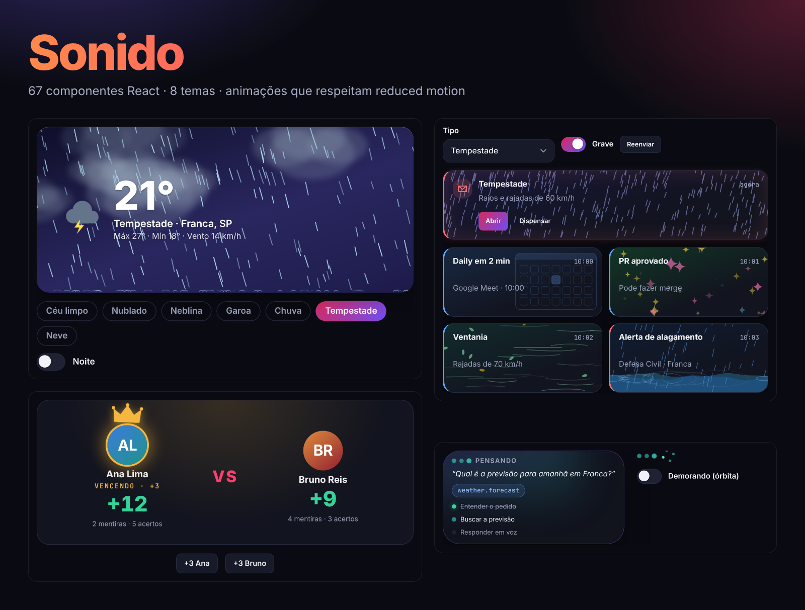
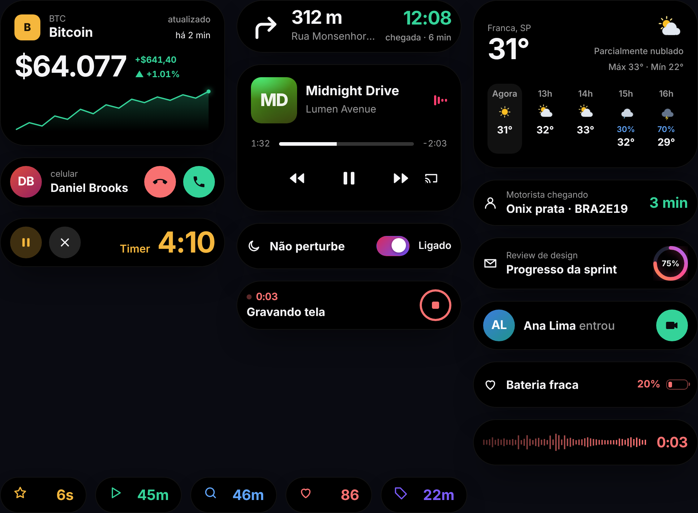
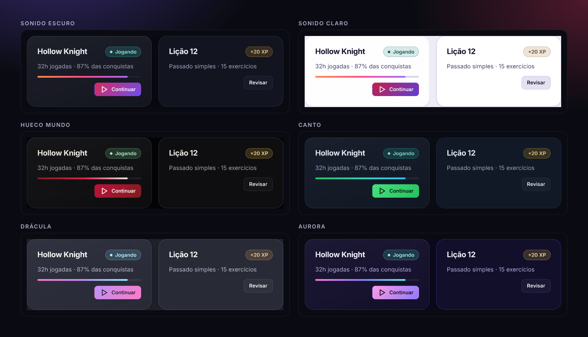

<div align="center">



# Sonido

**O design system dos apps do juninmd, em React.**
Escuro por padrão, vidro sobre um fundo atmosférico, cor com função e movimento que responde ao toque.

[](https://www.npmjs.com/package/@juninmd/sonido)
[](https://github.com/juninmd/sonido/actions/workflows/ci.yml)
[](https://juninmd.github.io/sonido/)
[](https://github.com/semantic-release/semantic-release)
[](LICENSE)

[**Documentação ao vivo**](https://juninmd.github.io/sonido/) · [Começar](#começar) · [Componentes](#componentes) · [Temas](#temas) · [Contribuir](#contribuir)

</div>

---

## Por que Sonido

|                             |                                                                                                   |
| --------------------------- | ------------------------------------------------------------------------------------------------- |
| 🧩 **83 componentes**       | De botão a céu animado do clima, todos com tipos, teclado e ARIA.                                 |
| 🎨 **8 temas**              | Troque com um atributo: `data-theme="hueco-mundo"`. Tokens `--sn-*` em CSS e em JS.               |
| ✨ **Movimento com motivo** | Mola tátil, confete, cenas em canvas. Tudo desliga com `prefers-reduced-motion`.                  |
| ♿ **Acessível**            | Contraste AA nos 8 temas, auditado com axe. Alvos de 44px e foco visível.                         |
| 🧪 **Teste ao vivo**        | Cada página da documentação tem um editor: mude o código, veja o resultado, copie com os imports. |
| 📦 **Leve**                 | Sem dependências além do React. ESM, tree-shakeable, CSS em um arquivo.                           |

## Começar

```bash
npm install @juninmd/sonido
```

```tsx
import { Button, Card, CardTitle, ProgressBar, burst } from "@juninmd/sonido";
import "@juninmd/sonido/styles.css";

export function Licao() {
  return (
    <Card>
      <CardTitle>Lição 12</CardTitle>
      <ProgressBar value={0.6} label="Meta do dia" />
      <Button press onClick={(e) => burst(e.currentTarget)}>
        Concluir lição
      </Button>
    </Card>
  );
}
```

Coloque `class="sn-body"` no `<body>` para herdar fonte, cor e fundo do tema.

> 💡 Não sabe qual componente usar? Abra a [documentação](https://juninmd.github.io/sonido/), edite o exemplo e clique em **Copiar código**.

## Componentes

| Grupo                 | Componentes                                                                                                                                   |
| --------------------- | --------------------------------------------------------------------------------------------------------------------------------------------- |
| **Ações**             | Button, ConfirmButton                                                                                                                         |
| **Formulários**       | Checkbox, FilterChips, RadioGroup, Rating, SearchField, Select, Slider, Switch, TextField, ToggleCard                                         |
| **Exibição**          | Avatar, Badge, Kbd, Tooltip                                                                                                                   |
| **Feedback**          | Alert, EmptyState, LiveBadge, SaveIndicator, Skeleton, Spinner, Stamp, Toast                                                                  |
| **Superfícies**       | Accordion, AmbientBackdrop, Artwork, Bento, Card, Carousel, Dialog, Hero, PageHeader                                                          |
| **Navegação**         | Breadcrumb, CommandPalette, Dock, Menu, NavRail, Pagination, Stepper, Tabs                                                                    |
| **Dados**             | BarChart, CountUp, DataTable, Duel, Heatmap, MeterCard, Odometer, ProgressBar, ProgressRing, RadialClock, Sparkline, Stat, StatTile, Timeline |
| **Widgets**           | AgendaRail, AlertCard, RouteMap, WeatherIcon, WeatherSky                                                                                      |
| **Assistente**        | EmojiBurst, PresenceOrb, RadialMenu, SpeechBubble, ThinkingBubble                                                                             |
| **Movimento e temas** | Motion, ThemeSwitcher                                                                                                                         |

Utilitários: `burst` (confete), `accentStyle(hue)` (cor por seção), `useReducedMotion`, `useCanvasLoop`, `hueFrom`, `initials`, `cx`.

## Ilhas vivas

Pílulas escuras para atividades em andamento: chamada, timer, música, gravação, rota, cotação, clima e bateria. Ficam escuras em qualquer tema e usam a cor de destaque dele.



```tsx
<IslandCall name="Ana Lima" subtitle="celular" onAccept={atender} onDecline={recusar} />
<IslandTimer duration={25 * 60} label="Foco" onDone={tocar} />
<IslandChip icon={<Bike />} value="2,0 km" tone="gold" label="Pedalada: 2 km" />
```

## Temas



| Tema                   | Ativar                                            |
| ---------------------- | ------------------------------------------------- |
| Sonido escuro (padrão) | nada, é o `:root`                                 |
| Sonido claro           | `data-theme="light"`                              |
| Hueco Mundo            | `data-theme="hueco-mundo"`                        |
| Canto · Canto claro    | `data-theme="canto"` · `data-theme="canto-claro"` |
| Drácula                | `data-theme="dracula"`                            |
| Glass                  | `data-theme="glass"`                              |
| Aurora                 | `data-theme="aurora"`                             |

```ts
document.documentElement.dataset.theme = "aurora";
// ou <ThemeSwitcher value={tema} onChange={setTema} /> com a lavada circular
```

Tokens em JS: `import { color, space, duration } from "@juninmd/sonido/tokens"`. Só as variáveis: `@juninmd/sonido/tokens.css`.

## De onde veio cada peça

Sonido junta o melhor dos apps do juninmd:

| Origem                                        | O que trouxe                                                                                                              |
| --------------------------------------------- | ------------------------------------------------------------------------------------------------------------------------- |
| games-gallery                                 | Dock com ampliação, Hero, Card com tilt, AmbientBackdrop, ProgressRing, CountUp, Toast                                    |
| nerd-watch                                    | Tokens base, CommandPalette, Carousel, NavRail, BarChart, Artwork, confete                                                |
| canto-widget                                  | Tema Hueco Mundo e os 5 skins do canto, WeatherSky, AlertCard com 19 cenas, RouteMap, AgendaRail, Tabs, DataTable         |
| pobre-lingo                                   | Botão tátil, curva de mola, Rating e ProgressBar gamificados                                                              |
| mika                                          | PresenceOrb, ThinkingBubble, SpeechBubble, RadialMenu, EmojiBurst, PageHeader, StatTile, ToggleCard, SaveIndicator, Bento |
| ai-session-monitor                            | ThemeSwitcher, MeterCard                                                                                                  |
| franca-segura · eleicoes-radar · treta-aovivo | Heatmap, RadialClock, Odometer, Stamp, LiveBadge, Duel                                                                    |
| faxina                                        | Release com semantic-release e commitlint                                                                                 |

## Desenvolvimento

```bash
npm install
npm run dev          # Storybook em http://localhost:6006
npm run check        # lint + tipos + auditoria do design system + testes
npm run build        # pacote em dist/
npm run build:docs   # site estático em storybook-static/
```

Os testes montam **todos os exemplos da documentação**, então o código que você copia da doc sempre funciona.

### Skills de auditoria

Em `.claude/skills/` há três skills para o Claude Code:

- **sonido-audit**: roda `npm run audit:ds`, lint, tipos e testes e corrige o que falhar.
- **sonido-a11y**: axe-core nos exemplos em todos os temas.
- **sonido-component**: passo a passo para criar ou portar um componente.

## Releases

Versões saem sozinhas a cada merge na `main`, pelo [semantic-release](https://github.com/semantic-release/semantic-release), a partir das mensagens de commit:

| Commit                        | Versão        |
| ----------------------------- | ------------- |
| `fix(button): foco no Safari` | patch `1.0.1` |
| `feat(toast): ação desfazer`  | minor `1.1.0` |
| `feat!: remove a prop tone`   | major `2.0.0` |

O commitlint valida as mensagens no `commit-msg` (husky) e no CI.

## Contribuir

1. Crie uma branch, faça commits semânticos e abra um PR.
2. O CI roda lint, tipos, auditoria, testes, build do pacote e da documentação.
3. No merge, a `main` publica no npm e atualiza a documentação.

## Licença

[MIT](LICENSE) © juninmd
